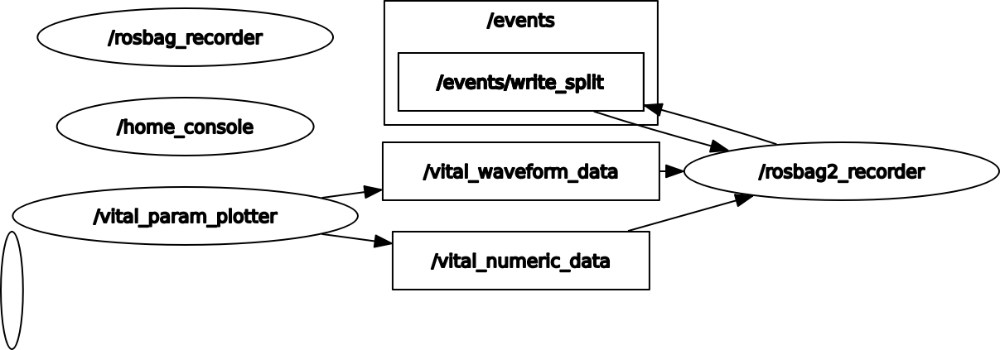
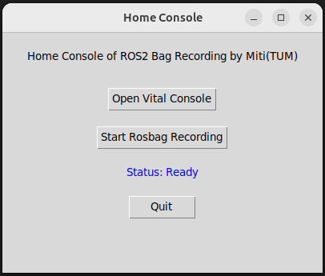
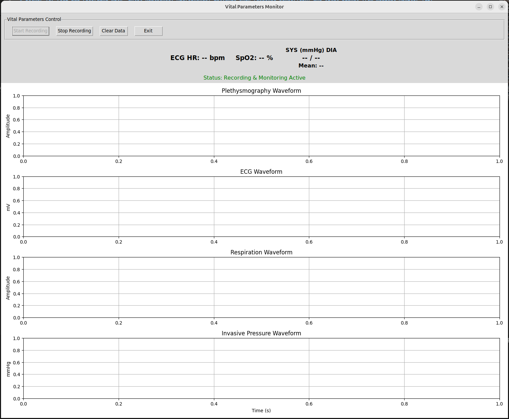

# Docker for ros2 bag recording with vital parameter monitor

## 1. Requirements
- GE medical Monitor Bx50 or Datex S/5 or Dash (tested with GE b450)
- 2 ATEN UC232A-USB adapters connected with Null Modem F/F cable. 
- VitalSignsCapture (appended in this repository)
- Docker
- Docker Compose

## 2. Get started

1. **Clone the repository:**
```bash
git clone https://gitlab.lrz.de/centre-of-clinical-robotics/templates/vital-parameter-recording
cd vital-paramter-recording
```

2. **Run the container:**
Navigate to the `docker` directory and run the start script:
```bash
cd docker
chmod +x run.sh
./run.sh
```
This will build the Docker image and start the container. The GUI for the GSR recorder should appear.
Keep this terminal and open a new one to enter the container:
```shell
docker exec -it vital-param-recorder bash
```
Then you have entered the container environment with root path:`root@USER:/ros2_ws# ` You can now get access to all about ROS2 Humble now.

## 3. Launching Sensor Nodes

You can get an overview of the nodes and topics in the workspace `ros2_ws` from this rosgraph:


### Running the entire System
Run the home console to get access to the vital recording and rosbag recording.
```shell
ros2 run user_interface ui_home
```


### Recording vital signals from Monitor GE Carescape b450
This package uses VSCapture to record data from medical monitor. To connect to the medical monitor, read the hardware connection guide by [vital recorder](https://vitaldb.net/docs/). To get an overview of the available sensors for vital signals on GE Bx50. Read this [catalog](https://www.gehealthcare.de/-/media/global/dach/files/lcs/mini-catalogues-lcs_b450_b650_b850_de_jb63920xeb.pdf?rev=-1). If you just want to run VSCapture with your own configuration arguments, run:
```shell
run_vscapture.sh \
  --devices 1 \
  --device1type 1 \
  --device1model 2 \
  --device1arg "-port /dev/ttyUSB0 -interval 1 -export 4 -waveset 2"
```

When VSCapture running, it will save all vital signal in .json and .csv files. There are 2 kinds of vital signal. If a vital parameter is shown as label in monitor, it will be recognized as numeric data and all numeric data are saved in one file. If a vital parameter can be plotted as live diagram in monitor, it is recognized as waveform and each waveform data is saved in its own .csv file. Then the ros2 node `/vital_param_plotter`will read latest data from these files and plot them in GUI. So it is more recommended to run VSCapture in GUI. Also you can see the plotting of the vital parameters in realtime:
```shell
ros2 run vital_recording ui_vital
```



## 4. Foxglove Bridge — Live Visualisation ⚠️ *[UPDATED: Separate topics instead of arrays]*

The Foxglove Bridge streams all ROS 2 topics to [Foxglove Studio](https://foxglove.dev) over WebSocket, allowing live visualisation without entering the container.

> **Recent change:** Topics are now published as separate named topics (e.g., `/numeric_ecg_hr`, `/waveform_pleth`) instead of bundled into `Float32MultiArray`. This makes Foxglove panel subscription simpler and avoids timestamp confusion when plotting.

### 4.1 Starting the bridge

```bash
cd ~/Documents/vitals-module/docker
sudo docker compose up -d foxglove-bridge
```

### 4.2 Connecting Foxglove Studio

1. Open Foxglove Studio
2. Click **Open connection**
3. Select **Foxglove WebSocket**
4. Enter URL: `ws://localhost:8765`

> **Note:** Topics only appear after `ui_vital` is running inside the container **and** the **Start Recording** button has been pressed in the GUI.

### 4.3 Available topics

**Numeric Vitals (10 Hz):**

| Topic | Type | Description |
|---|---|---|
| `/numeric_ecg_hr` | `Float32` | ECG heart rate in bpm |
| `/numeric_spo2` | `Float32` | Oxygen saturation in % |
| `/numeric_nibp_sys` | `Float32` | Systolic blood pressure in mmHg |
| `/numeric_nibp_dia` | `Float32` | Diastolic blood pressure in mmHg |
| `/numeric_nibp_mean` | `Float32` | Mean blood pressure in mmHg |

**Waveforms (100-250 Hz depending on sensor):**

| Topic | Type | Description |
|---|---|---|
| `/waveform_pleth` | `Float32` | Plethysmography waveform sample |
| `/waveform_ecg1` | `Float32` | ECG waveform sample (mV) |
| `/waveform_resp` | `Float32` | Respiration waveform sample |
| `/waveform_invp1` | `Float32` | Invasive pressure waveform sample (mmHg) |

> **Note:** All topics publish individual `Float32` messages. Values are `-1.0` when no data is available. Each topic represents one logical signal, eliminating array indexing confusion and making Foxglove panel subscription straightforward.

### 4.4 Viewing data in Foxglove Studio

**Numeric Vitals (scalars):**
- Add a **Gauge** or **State** panel → subscribe to any `/numeric_*` topic

**Waveforms (time-series with lines):**
- Add a **Plot** panel → subscribe to any `/waveform_*` topic
- Enable "Show lines" in the panel settings for sparse low-frequency data to appear connected
- Example: `/waveform_pleth` for plethysmography, `/waveform_ecg1` for ECG waveform

**All topics with raw values:**
- Add a **Raw Messages** panel → subscribe to any topic to see the latest Float32 value

> **Tip:** Each topic name is now self-documenting, so you know exactly which signal you're looking at without counting array indices.

### 4.5 Troubleshooting ⚠️ *[NEW — TO BE CHECKED]*

**Check bridge is healthy:**
```bash
sudo docker inspect foxglove_bridge --format='{{.State.Health.Status}}'
```

**Check topics are publishing:**
```bash
sudo docker exec vital-param-recorder bash -c "source /opt/ros/humble/setup.bash && ROS_DOMAIN_ID=42 ros2 topic list"
```

**Watch bridge logs live:**
```bash
sudo docker logs foxglove_bridge -f
```

**No data in Foxglove despite topics being visible:**
Both containers must have `ipc: host` set in `docker-compose.yml`. Without it, FastDDS shared memory is blocked between containers and no messages are delivered even though topics are discoverable.

---

## 5. Starting the vital recorder ⚠️ *[NEW — TO BE CHECKED]*

Always start `ui_vital` with `ROS_DOMAIN_ID=42` set explicitly. Without it the node runs on domain 0 and is invisible to the Foxglove bridge (domain 42):

```bash
sudo docker exec -it vital-param-recorder bash -c "export ROS_DOMAIN_ID=42 && ros2 run vital_recording ui_vital"
```

> **Note:** This will be fixed permanently after rebuilding the image with `docker compose up --build`.

---

## 6. Export files from the container to outside

### 4.1 Exported data
You can check all exported data from sensors at `/export`. Check rosbag data for all topics at `/export/rosbag`.

### 4.2 Manuelly export dats
Run the command outside the container to export files generated inside the container.
```shell
docker cp <container_name>:/path/in/container /path/on/host
```
For example, if you have exported a rosgraph using rqt_graph, you can save it to the specific folder `/ros2_ws/outputs` and export it to the Desktop. 
```shell
docker cp vital-param-recorder:/export/rosgraph.png ~/Desktop/
```
