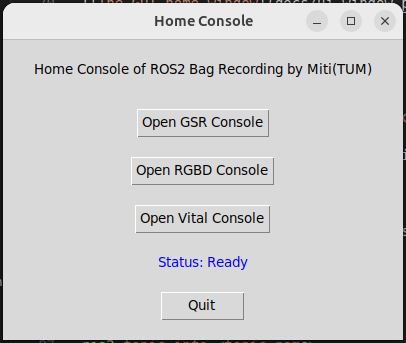

# Docker for ros2 bag recording with vital parameter monitor

## 1. About Docker 
This project provides a fully containerized ROS 2 (Humble) environment tailored for vital parameter data acquisition. The Docker setup is designed to simplify deployment across systems.

The system is built using a Dockerfile based on the ros:humble-perception image and is managed via docker-compose. Two main Compose configurations are provided:
   - **docker-compose.yml**: Base setup with device access and privilege escalation.

   - **docker-compose-gui.yml**: Extends the base configuration for GUI applications, enabling visualization through X11 display sharing.

## 2. Getting started
Navigate to the `docker` directory and run the start script:
```bash
cd docker
./run.sh
```
This will build the Docker image and start the container. The GUI for the GSR recorder should appear.

Then you have started the container `vital-param-recording`. Press `Ctrl+C`to stop the container.
Keep this terminal and open a new one to enter the container:
```shell
docker exec -it docker-recording bash
```
Then you have entered the container environment with root path:`root@USER:/ros2_ws# ` You can now get access to all about ROS2 Humble now.

## 3. Launching The UI

First source relevant files:
```shell
source install/setup.bash
```

### Running the entire System
Run the home console to get access to the vital recording and rosbag recording.
```shell
ros2 run user_interface ui_home
```


### Recording vital signals from Monitor GE Carescape b450
VSCapture is added in this respository. If you just want to run VSCapture with your own configuration arguments, run:
```shell
run_vscapture.sh \
  --devices 1 \
  --device1type 1 \
  --device1model 2 \
  --device1arg "-port /dev/ttyUSB0 -interval 1 -export 4 -waveset 2"
```

But it is more recommended to run VSCapture in GUI. Also you can see the plotting of the vital parameters in realtime:
```shell
ros2 run vital_recording ui_vital
```


## 4. Export files from the container to outside
Run the command outside the container to export files generated inside the container.
```shell
docker cp <container_name>:/path/in/container /path/on/host
```
For example, if you have exported a rosgraph using rqt_graph, you can save it to the specific folder `/ros2_ws/outputs` and export it to the Desktop. 
```shell
docker cp docker-recording:/ros2_ws/outputs/rosgraph.png ~/Desktop/
```
