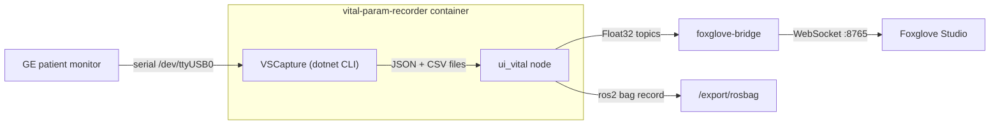

# Vital Parameter Recording

A ROS 2 module that captures live vital signs from a GE patient monitor via
[VSCapture](https://vitaldb.net/), publishes each signal as its own ROS 2 topic,
records everything to a rosbag, and streams the data to
[Foxglove Studio](https://foxglove.dev) for live visualisation. Part of the
6G-life / MITI STES project.

Everything runs in Docker and starts with a single command.

> **Hardware BOM:** the bill of materials (with part photos) is in [`docs/BOM.xlsx`](docs/BOM.xlsx).

## Quick start

1. **Clone the repository:**

```bash
git clone https://gitlab.lrz.de/6g-life_MITI/stes/vitals-module.git
cd vitals-module
```

2. **Start everything with one command:**

```bash
cd docker
./run.sh
```

That's it. The script builds the images, starts both containers, begins recording,
and opens Foxglove Studio once the data stream is ready.

> **First run:** the initial image build (rosdep + colcon) takes roughly
> **10-20 minutes** and is mostly silent — this is expected, not a hang.
> Subsequent runs reuse the cached image and start in seconds.

Press `Ctrl-C` to detach from the log stream — **the containers keep running**.
To stop the whole system:

```bash
docker compose -f docker-compose.yml down
```

### What `run.sh` does

The launcher ([docker/run.sh](docker/run.sh)) is the only thing you need to run.
It:

- allows X11 forwarding and fixes serial-port permissions on `/dev/ttyUSB0`,
- runs `docker compose up -d`, bringing up **both** services
  (`vital-param-recorder` and `foxglove-bridge`),
- the recorder container **auto-starts** the `ui_vital` node, which launches
  VSCapture, live monitoring, and rosbag recording — no manual node launch needed,
- waits for the Foxglove bridge, then **opens Foxglove Studio auto-connected** to
  `ws://localhost:8765` (desktop app if installed, otherwise the hosted web app),
- streams the container logs to your terminal.

## Requirements

**Software**

- Docker
- Docker Compose
- Foxglove Studio (optional — `run.sh` falls back to the hosted web app in your browser)

**Hardware**

- A GE medical monitor: GE Carescape B450 (tested), or another Bx50 / Datex S/5 / Dash.
- 2x ATEN UC232A USB-to-serial adapters connected with a Null-Modem F/F cable,
  appearing on the host as `/dev/ttyUSB0`.
- An X11 display (the GUI tooling inside the container needs `$DISPLAY`).

For wiring the monitor to the serial adapters, see the hardware connection guide
from [VitalDB](https://vitaldb.net/docs/). For the list of available signals on a
GE Bx50, see the
[GE B450/B650/B850 catalogue](https://www.gehealthcare.de/-/media/global/dach/files/lcs/mini-catalogues-lcs_b450_b650_b850_de_jb63920xeb.pdf?rev=-1).

## How it works



The `vital-param-recorder` container auto-starts the `ui_vital` node
([container-startup.sh](docker/container-startup.sh) execs it as PID 1 when
`AUTOSTART=1`, the default). That node
([ui_vital.py](ros2_ws/src/vital_recording/vital_recording/ui_vital.py)):

1. starts VSCapture, which writes numeric data to a JSON file and each waveform to
   its own CSV file,
2. tails those files and republishes every signal as an individual `Float32` topic,
3. starts a `ros2 bag record` of all vital topics into `/export/rosbag/<timestamp>`.

Both containers run on `ROS_DOMAIN_ID=42` and share `ipc: host` so the Foxglove
bridge can see the recorder's topics.

## Foxglove visualisation

`run.sh` opens Foxglove Studio for you, already connected to `ws://localhost:8765`.
No manual connection step is needed.

**Load the dashboard:** the auto-connect does not load a layout. Import
[Vital_Monitor.json](Vital_Monitor.json) once via **Layouts -> Import layout**
(or drag-and-drop the file into the Foxglove window) to get the pre-built
vital-monitor dashboard.

If you ever need to connect by hand: **Open connection -> Foxglove WebSocket ->**
`ws://localhost:8765`.

> Topics appear once `ui_vital` is running (which `run.sh` starts automatically).

### Available topics

**Numeric vitals (10 Hz):**

| Topic | Type | Description |
|---|---|---|
| `/numeric_ecg_hr` | `Float32` | ECG heart rate in bpm |
| `/numeric_spo2` | `Float32` | Oxygen saturation in % |
| `/numeric_nibp_sys` | `Float32` | Systolic blood pressure in mmHg |
| `/numeric_nibp_dia` | `Float32` | Diastolic blood pressure in mmHg |
| `/numeric_nibp_mean` | `Float32` | Mean blood pressure in mmHg |
| `/numeric_nibp` | `String` | Combined `sys/dia` reading (e.g. `120/80`) |

**Waveforms:**

| Topic | Type | Rate | Description |
|---|---|---|---|
| `/waveform_pleth` | `Float32` | 100 Hz | Plethysmography waveform sample |
| `/waveform_ecg1` | `Float32` | 250 Hz | ECG waveform sample (mV) |
| `/waveform_resp` | `Float32` | 25 Hz | Respiration waveform sample |
| `/waveform_invp1` | `Float32` | 125 Hz | Invasive pressure waveform sample (mmHg) |

> Each topic publishes one value per message — no array indexing. A value of
> `-1.0` means no data is available for that signal.

**Panel tips:** use a **Gauge** or **State** panel for `/numeric_*` topics, and a
**Plot** panel for `/waveform_*` topics. For the sparse 10 Hz numeric signals,
enable "Show lines" in the Plot panel so the points appear connected.

## Recorded data and export

- All sensor exports are written to `/export` inside the container (mounted to
  `../export` on the host).
- Rosbags are saved to `/export/rosbag/<timestamp>`.

To copy any other file out of a running container manually:

```bash
docker cp <container_name>:/path/in/container /path/on/host
# e.g.
docker cp vital-param-recorder:/export/rosgraph.png ~/Desktop/
```

## Manual use and debugging

To get a shell instead of the auto-started node, disable autostart and attach:

```bash
AUTOSTART=0 docker compose -f docker-compose.yml up --build -d
docker exec -it vital-param-recorder bash
```

Inside the container you have the full ROS 2 Humble environment and can run nodes
by hand, for example:

```bash
# start the recorder node explicitly (keep the domain id)
export ROS_DOMAIN_ID=42 && ros2 run vital_recording ui_vital
```

`docker exec ... bash` works even while the node is auto-running.

**Custom VSCapture configuration:** the wrapper script accepts VSCapture's CLI
arguments directly if you need a different device, port, or waveset:

```bash
run_vscapture.sh \
  --devices 1 \
  --device1type 1 \
  --device1model 2 \
  --device1arg "-port /dev/ttyUSB0 -interval 1 -export 4 -waveset 2"
```

## Troubleshooting

**Serial port not accessible:** ensure the adapter is on `/dev/ttyUSB0` and
readable. `run.sh` runs `sudo chmod 666 /dev/ttyUSB0`; re-plug the adapter if it
enumerated under a different number.

**No data in Foxglove despite topics being visible:** both containers must have
`ipc: host` set in [docker-compose.yml](docker/docker-compose.yml). Without it,
FastDDS shared memory is blocked between containers and no messages are delivered
even though topics are discoverable.

**Check the bridge is healthy:**

```bash
docker inspect foxglove_bridge --format='{{.State.Health.Status}}'
docker logs foxglove_bridge -f
```

**Check topics are publishing:**

```bash
docker exec vital-param-recorder bash -c \
  "source /opt/ros/humble/setup.bash && ROS_DOMAIN_ID=42 ros2 topic list"
```

> **Advanced — smoother plots:** waveform topics render as continuous curves out
> of the box. The 10 Hz numeric signals update in visible steps; if you want them
> smoothed, add a Foxglove **User Script** that linearly interpolates between
> samples and plot the interpolated output topic.

## License

See [License.md](License.md).
